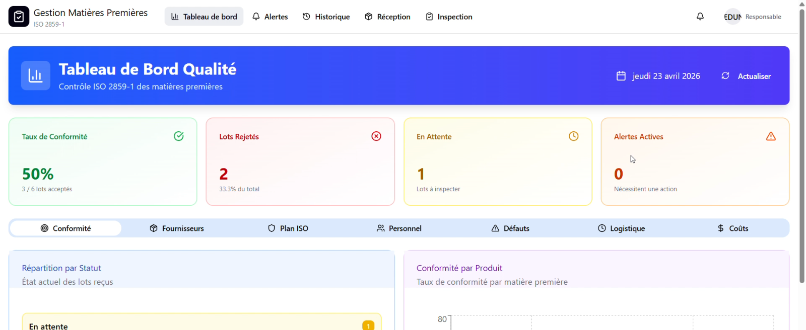
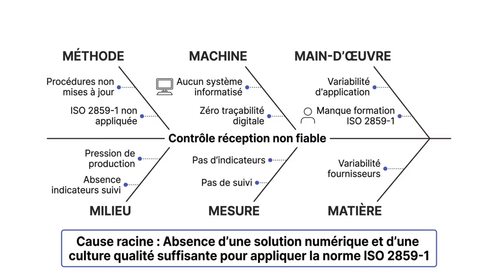
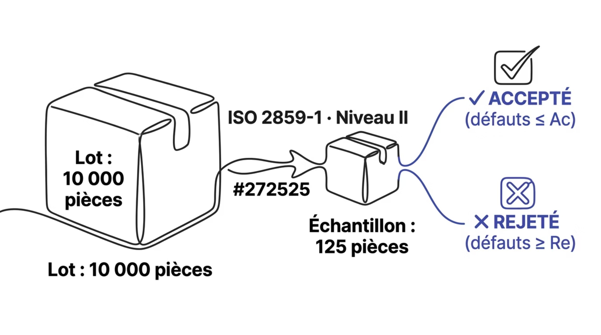
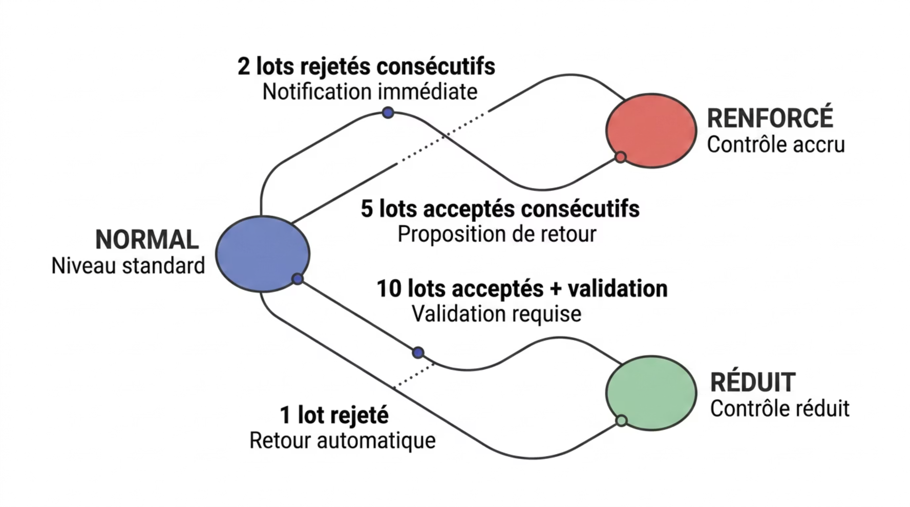
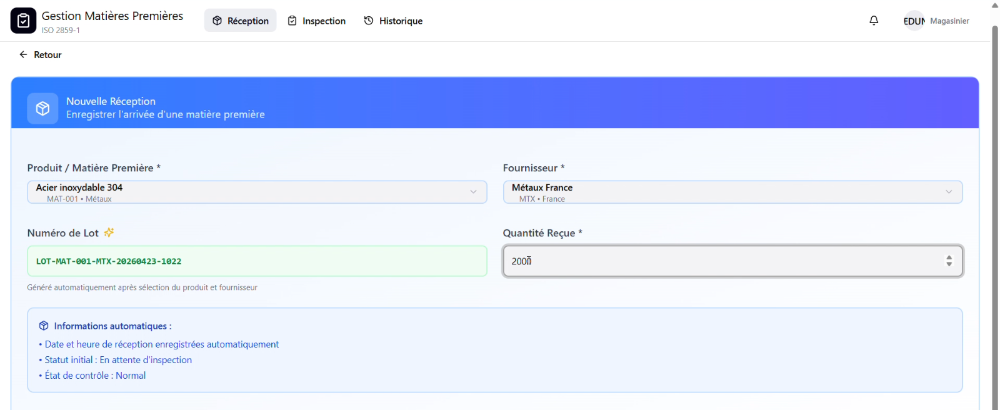
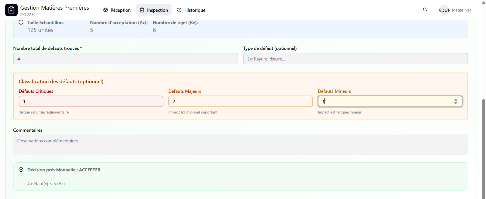
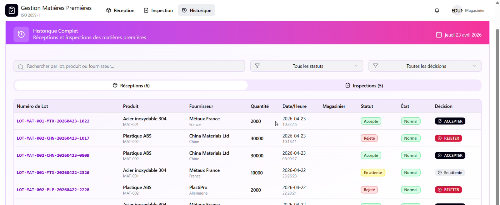

# Contrôle qualité des matières premières

Application web réalisée pendant mon stage chez SIDILEC International (juin – juillet 2025), fabricant de câbles pour l'automobile. Elle numérise la réception et le contrôle qualité des matières premières selon la norme **ISO 2859-1**.

## 1. Diagnostic

Le contrôle à la réception reposait sur le papier, sans application de la norme ISO 2859-1 ni traçabilité. L'analyse des causes (diagramme d'Ishikawa, 5 Pourquoi) a montré que la cause principale était l'absence d'outil numérique et de culture qualité autour de la norme.

## 2. La norme ISO 2859-1

Pour chaque lot reçu, la norme fixe la taille de l'échantillon à contrôler et les seuils d'acceptation (Ac) et de rejet (Re), selon la taille du lot et le niveau de qualité acceptable (AQL).

Le niveau de contrôle évolue selon l'historique du fournisseur : normal, renforcé après des rejets, réduit après une série de lots acceptés.

## 3. L'application

- **Réception** des lots par le magasinier.
- **Calcul automatique** de la taille d'échantillon et des critères d'acceptation ou de rejet selon l'ISO 2859-1.
- **Inspection** et décision d'acceptation ou de rejet du lot.
- **Passage automatique** entre contrôle normal, renforcé et réduit.
- **Tableau de bord** du responsable qualité : statistiques, alertes et historique.
- Deux profils : magasinier et responsable qualité.

**Réception d'un lot** : le magasinier enregistre le produit, le fournisseur et la quantité ; le numéro de lot est généré automatiquement.

**Inspection** : l'application calcule l'échantillon (ici 125 unités, Ac = 5, Re = 6), classe les défauts et propose la décision (4 défauts ≤ 5 : lot accepté).

**Historique** des réceptions et des inspections, avec le statut et la décision de chaque lot.

Les captures ont été réalisées avec des données de test.

Technologies : React, TypeScript, Vite, Tailwind, Supabase (PostgreSQL, authentification et fonction serveur).

| Dossier | Rôle |
|---|---|
| `src/components/` | Pages par profil : `magasinier/` (réception, inspection), `responsable/` (tableau de bord, alertes), `shared/` (historique, aide ISO) |
| `src/utils/iso2859-data.ts` | Tables de la norme : lettre-code, taille d'échantillon, critères Ac/Re |
| `src/supabase/functions/server/` | API côté serveur : lots, inspections, passage normal / renforcé / réduit |
| `src/components/ui/` | Composants d'interface [shadcn/ui](https://ui.shadcn.com/) (licence MIT) |

## Lancer le projet

1. Créer un fichier `.env` avec `VITE_SUPABASE_PROJECT_ID` et `VITE_SUPABASE_ANON_KEY` (votre propre projet Supabase).
2. `npm install`
3. `npm run dev`
